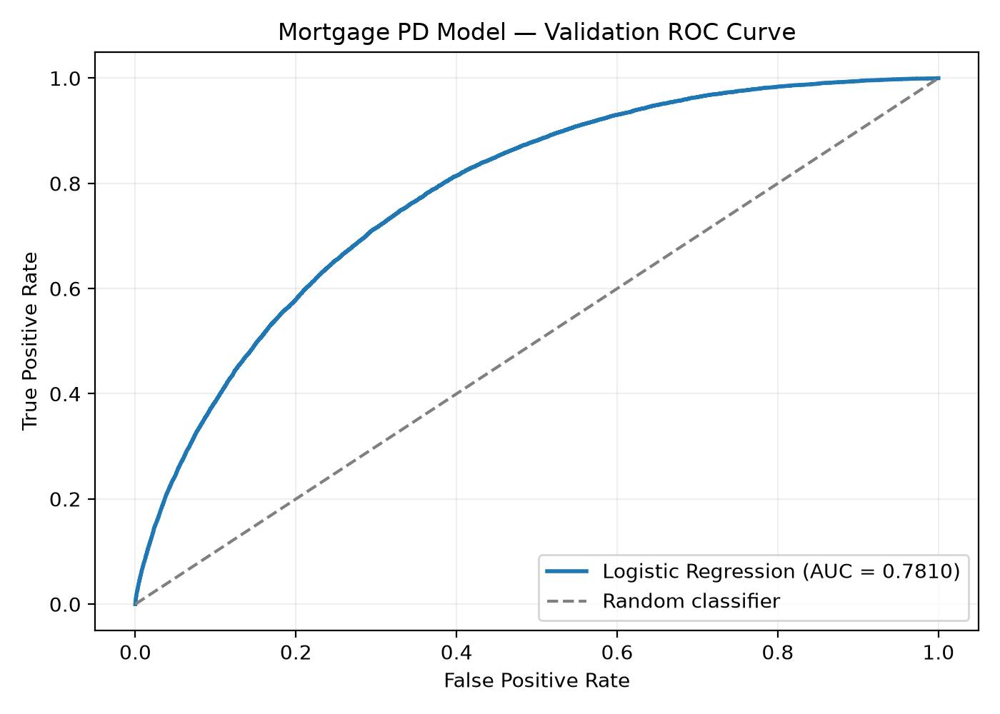
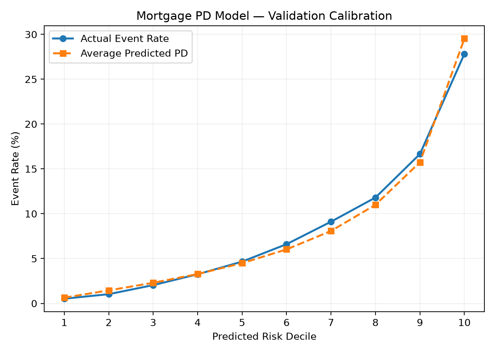

# Mortgage Credit Risk | Model Development, Validation & Governance

An end-to-end mortgage credit risk modeling project using Freddie Mac's historical single-family loan-level data.

The project demonstrates the development, quantitative validation, and governance assessment of mortgage credit risk models, with emphasis on predictive performance, probability calibration, model limitations, and model risk management.

**Project Status:** Research assessment completed | Five validation findings remain open | Not recommended for production use

## Project Overview

**Objective:** Estimate the likelihood of observed serious mortgage delinquency (90+ days past due) within a 24-month observation horizon.

The project covers:

- Processing and validating large-scale mortgage loan-level data.
- Constructing a serious-delinquency outcome and modeling population.
- Developing Logistic Regression, Random Forest, and XGBoost models.
- Evaluating discrimination, calibration, feature stability, and sensitivity to modeling assumptions.
- Documenting validation findings, governance decisions, and remediation recommendations.

The outcome serves as a serious-delinquency proxy for default. The target definition remains provisional and should not be interpreted as a validated production Probability of Default (PD) measure.

## Governance & Control Outcomes

This project demonstrates how quantitative analysis can
support risk oversight, control assessment, issue
management, and documented model-use decisions.

| Governance Activity | Evidence and Outcome |
|---|---|
| Data Quality Controls | Validated loan identifiers, reporting dates, duplicate records, and data reconciliation |
| Risk Identification | Documented five model validation findings |
| Issue Prioritization | Assigned proposed remediation priorities and tracked unresolved issues |
| Reporting & Analysis | Compared predicted versus observed risk and identified material Q4 underprediction |
| Governance Assessment | Evaluated model limitations and documented a production-use recommendation |
| Remediation Planning | Proposed corrective actions and requirements for future reconsideration |

**Key governance decision:** Despite useful discriminatory
performance, neither model was recommended for production
probability estimation because of material calibration
and methodology limitations.

**[Read the Executive Risk Assessment](docs/executive_risk_assessment.md)**

## Project Results

### Dataset

| Description | Value |
|---|---:|
| Mortgage origination records | 1,238,192 |
| Monthly loan-performance records | 74,478,724 |
| Primary modeling population | 888,123 |
| Observed serious-delinquency events | 59,785 |
| Origination year | 2007 |

**Data source:** Freddie Mac Single-Family Loan-Level Dataset.

### Modeling Approach

| Dataset | Origination Cohort | Mortgages | Purpose |
|---|---|---:|---|
| Training | 2007 Q1–Q2 | 488,486 | Model development |
| Validation | 2007 Q3 | 188,212 | Model evaluation and selection |
| Final Test | 2007 Q4 | 211,425 | Held-out evaluation |

The chronological split evaluates performance on later 2007 origination cohorts. It does not constitute testing across different origination years or economic environments.

### Final Held-Out Test Results

Two frozen model specifications were evaluated on the reserved 2007 Q4 cohort:

- **Logistic Regression:** Five origination-time features, excluding CLTV.
- **XGBoost:** Six origination-time features, with boosting rounds selected during validation.

| Metric | Logistic Regression | XGBoost |
|---|---:|---:|
| ROC-AUC | 0.7906 | **0.7956** |
| Average Precision | 0.2910 | **0.3073** |
| Brier Score | 0.0783 | **0.0774** |
| Average Predicted Event Rate | 6.39% | 6.39% |
| Observed Event Rate | 9.54% | 9.54% |

**Key finding:** XGBoost achieved stronger discrimination and a slightly lower Brier Score. However, both models underestimated the observed Q4 event rate by approximately **3.15 percentage points**.

Underprediction occurred across all ten risk deciles for both models, with larger absolute calibration errors in higher-risk groups.

The final evaluation demonstrates that useful risk-ranking performance does not necessarily imply reliable probability estimates.

## Model Development

Three modeling approaches were developed and compared using the original 2007 Q3 validation population.

| Metric | Logistic Regression | Random Forest | XGBoost |
|---|---:|---:|---:|
| ROC-AUC | 0.7810 | 0.7816 | **0.7843** |
| Average Precision | 0.2488 | 0.2518 | **0.2579** |
| Brier Score | 0.0696 | 0.0693 | **0.0691** |

The original Logistic Regression baseline used six mortgage origination characteristics:

- Credit score
- Original Loan-to-Value (LTV)
- Original Combined LTV (CLTV)
- Debt-to-Income (DTI)
- Interest rate
- Loan amount

Median imputation and, where applicable, feature scaling were fitted using training data only.

A feature-reduction analysis identified substantial correlation between LTV and CLTV. Removing CLTV produced comparable validation performance, supporting a simpler five-feature Logistic Regression candidate for final testing.

### Baseline Model Visualizations

**Logistic Regression — ROC Curve (Q3 Validation)**

**Logistic Regression — Calibration (Q3 Validation)**

These figures represent the original six-feature Logistic Regression baseline on Q3 validation data, not the final Q4 evaluation.

## Model Validation

A separate, self-conducted research validation workstream assessed model reliability and limitations.

The analysis included:

- Data integrity and loan-identifier reconciliation.
- Modeling-population representativeness.
- Alternative early-payoff target assumptions.
- Population Stability Index (PSI) analysis.
- Interest-rate segment calibration.
- LTV/CLTV multicollinearity and feature reduction.
- Discrimination and calibration on the reserved Q4 cohort.

### Validation Findings

| Finding ID | Description | Status |
|---|---|---|
| MV-001 | Sensitivity to early-payoff treatment | Open |
| MV-002 | Potential modeling-population selection bias | Open |
| MV-003 | Interest-rate distribution shift and segment-level calibration | Open |
| MV-004 | LTV/CLTV multicollinearity and coefficient interpretability | Open |
| MV-005 | Systematic probability underprediction in Q4 testing | Open |

**Important limitations:**

- The 24-month outcome definition and early-payoff treatment remain provisional.
- Excluding incomplete observation histories may introduce selection bias.
- Interest-rate distributions changed substantially between training and validation cohorts.
- All origination cohorts are from 2007, limiting evidence of generalizability across economic periods.
- Final Q4 results revealed material underprediction of observed serious-delinquency rates.

This is an individual research validation exercise, not an organizationally independent model validation.

## Model Governance

The project includes a documented model inventory, risk assessment, model-selection framework, final test protocol, validation findings register, and proposed monitoring and remediation activities.

**Final research assessment:**

- **XGBoost:** Stronger candidate for research-level risk ranking.
- **Five-feature Logistic Regression:** Interpretable benchmark.
- **Validation disposition:** Material limitations identified; five findings remain open.
- **Production recommendation:** Not recommended for production probability estimation.

The models are not production-approved. Governance procedures are research proposals and do not represent controls operated by a financial institution.

## Explore the Project

| Documentation | Description |
|---|---|
| [Executive Risk Assessment](docs/executive_risk_assessment.md) | Management-level summary of key risks, validation findings, priorities, and recommended actions |
| [Model Development](docs/model_development.md) | Modeling population, features, preprocessing, algorithms, validation results, and interpretability |
| [Model Validation](docs/model_validation.md) | Population analysis, sensitivity testing, stability diagnostics, calibration, and final validation conclusions |
| [Model Governance](docs/model_governance.md) | Model inventory, risk assessment, selection criteria, governance disposition, and remediation plan |
| [Final Test Protocol](docs/final_test_protocol.md) | Frozen model specifications, Q4 evaluation methodology, and held-out test results |

## Technology Stack

- **Python:** Modeling, preprocessing, and validation
- **DuckDB and SQL:** Large-scale mortgage data processing
- **pandas:** Data transformation and analysis
- **scikit-learn:** Logistic Regression, Random Forest, preprocessing, and evaluation
- **XGBoost:** Gradient-boosted decision trees
- **Parquet:** Efficient storage of processed loan-level data
- **Matplotlib:** Model performance visualizations
- **Git and GitHub:** Version control and project documentation

## Data Quality and Reproducibility

The data-processing workflow includes checks for:

- Unique mortgage origination identifiers.
- Origination-to-performance loan matching.
- Monthly reporting-date validity.
- Duplicate loan-month records.
- Quarterly record counts and schema consistency.

Model preprocessing is fitted on training data, with validation and held-out testing separated by origination cohort.

The original Freddie Mac files and generated loan-level datasets are excluded from this repository. Source data must be obtained separately through Freddie Mac.

## References

- [Freddie Mac — Single-Family Loan-Level Dataset](https://www.freddiemac.com/research/datasets/sf-loanlevel-dataset)
- [Freddie Mac — General User Guide](https://www.freddiemac.com/fmac-resources/research/pdf/user_guide.pdf)

---

**Project Scope:** Research, education, and portfolio demonstration. No production lending decisions, regulatory capital calculations, or operational credit risk reporting are supported by these models.